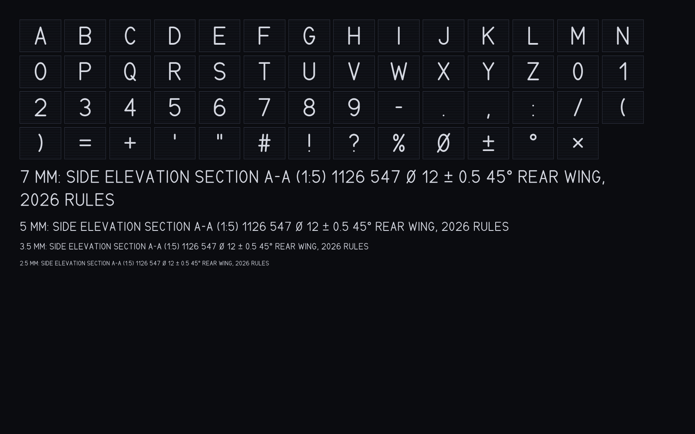

# ISO Lettering B

Engineering lettering for drawings, after ISO 3098 type B, vertical. Every character is drawn
as pen strokes from the standard's construction rules (capitals 10 line widths tall, a standard
capital 6 wide, character spacing 2, word spacing 6, baselines 14), not traced from any
existing font.



## Install

```sh
npm install @juansync7/iso-lettering
```

Or take the font file alone from `fonts/` in this folder.

## Use it as a font

`fonts/iso-lettering-b.otf` is an ordinary OpenType font (`@juansync7/iso-lettering/iso-lettering-b.otf`
in the package). Declare it and type normal text:

```css
@font-face {
  font-family: 'ISO Lettering B';
  src: url('@juansync7/iso-lettering/iso-lettering-b.otf') format('opentype');
}
.drawing {
  font-family: 'ISO Lettering B', monospace;
  /* Capitals stand 0.7 of the font size: for 3.5 mm capitals set 3.5 / 0.7 = 5 mm. */
  font-size: 5mm;
}
```

Lower case is set as capitals, as drawings are lettered. The character set is A to Z, 0 to 9,
`- . , : / ( ) = + ' " # ! ? %`, the middle dot, and the diameter, plus-minus, degree and
multiplication signs (56 in all).

## Use it as strokes

For a plotter, a laser or a canvas of lines, `textStrokes` gives each character as polylines in
grid units from the baseline's left end, and the text's width. Scale by h / 10 for capitals h high.
It has no dependencies and runs in a browser or Node.

```js
import { textStrokes } from '@juansync7/iso-lettering';

const { strokes, width } = textStrokes('SECTION A-A');
```

## Styles

ISO 3098 has type A (narrow, line width h/14) and type B (line width h/10), each upright or slanted
15°. This package has type B upright, as `ISO Lettering B`. Other styles of the same standard will
join it here.

## Build

```sh
npm install
npm run font    # write fonts/iso-lettering-b.otf from src/
npm run check   # fail if the committed font differs from what src/ builds
npm run build   # the package: dist/index.js and its types
```

The build is deterministic, so the font can never drift from its glyphs.

## Licence

SIL Open Font License 1.1 (`OFL.txt`). Use it, change it and ship it with your work. Made by
Juan Kok for the drawings on [juansync.dev](https://juansync.dev), part of his
[frontend kit](https://github.com/JuanSync7/frontend-kit). Report a problem with the
[lettering issue form](https://github.com/JuanSync7/frontend-kit/issues/new?template=iso-lettering.yml).
